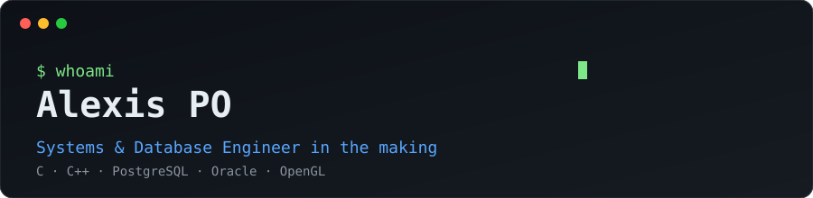

<p align="center">
  
</p>

<p align="center">
  
</p>

```bash
$ whoami
alexis — CS student & systems tinkerer, Mexico City

$ cat focus.txt
storage engines · query performance · reliability · real-time 3D graphics

$ status --open-to-work
internships / junior roles · backend · data infrastructure · systems
```

## 🚀 Featured projects

| | Project | What it is | Stack |
|---|---|---|---|
| 🗄️ | [**miniBD**](https://github.com/Alexisvop/miniBD) · [demo](https://minibd.pages.dev/) | Database engine built from scratch: paged storage, persistent B+ Tree indexing, query execution. | `C` |
| ⚡ | [**Oracle-Performance-Analyzer**](https://github.com/Alexisvop/Oracle-Performance-Analyzer) · [demo](https://oracle-performance-analyzer.pages.dev/) | Reproducible lab for execution plans, indexing strategies and evidence-driven benchmarking. | `Python` `SQL` `Oracle` |
| 🌍 | [**EcoSphere-3D**](https://github.com/Alexisvop/EcoSphere-3D) | Interactive 3D environmental-education platform. | `C++` `OpenGL` `GLSL` |

## 🧰 Tech stack

**Systems** &nbsp;    

**Data** &nbsp;    

**Graphics** &nbsp;  

**Tools** &nbsp;   

## 📊 Stats

<p align="center">
  
  
</p>

## 🌱 Currently learning
- WAL, crash recovery and streaming replication in PostgreSQL
- Query optimizer internals and B+ Tree performance
- Real-time rendering with OpenGL / GLSL

## 📫 Connect
[]()
[]()
